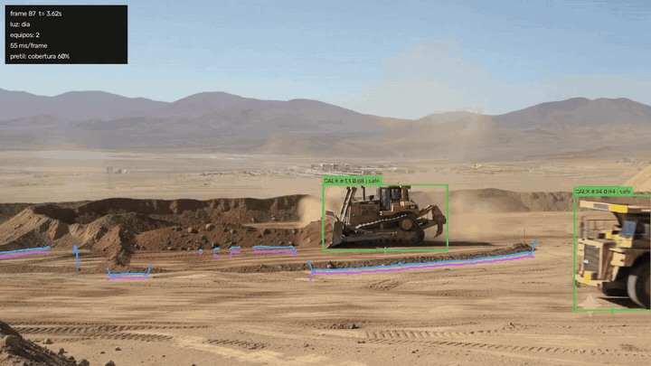
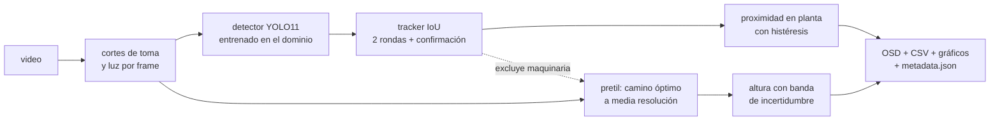

# BermGuard AI

[](https://github.com/xSempiternus/BermGuard/actions/workflows/ci.yml)


Visión por computadora para botaderos de minería a rajo abierto. Detecta camiones (CAEX) y
bulldozers, mide la proximidad entre ellos con niveles de riesgo que no parpadean, y traza
el pretil de seguridad con su altura. Corre en Docker con CUDA y cae a CPU si no hay GPU.



| | |
|---|---|
| **0.88** recall de CAEX en el video que el detector no vio, en el umbral de operación | **29** etiquetas mal clasificadas, encontradas y corregidas con una auditoría registrada |
| **hasta +15 pts** de exactitud del camino óptimo sobre argmax cuando la cresta es visible (escenas sintéticas) | **3.6–4.6×** más rápida la segmentación del pretil a media resolución |

**Lo que distingue a este proyecto es cómo está medido.** Las cifras llevan intervalos de
confianza y se miden en el umbral con el que opera el sistema. Cuando una medición mejor
contradijo una cifra anterior, la corregí y dejé registrado por qué (ADR 0008 a 0010).
[`docs/resultados.md`](docs/resultados.md) cuenta qué funciona y qué no.

**Pruébalo:** [`docs/showcase/demo_camino_optimo.html`](docs/showcase/demo_camino_optimo.html)
muestra en el navegador por qué el camino óptimo resiste las huellas de neumático que
engañan al argmax, y dónde deja de hacerlo.

> Los videos de muestra los generó el cliente con IA (Gemini) y su publicación está
> autorizada. El método se transfiere a video real; las cifras métricas absolutas, no
> ([`docs/analisis_material.md`](docs/analisis_material.md), sección 6).



Para ver el resultado completo, parte por `output_ejemplo/video_04/method_1/video_04_osd.mp4`:
es el único video que el detector no vio durante el entrenamiento. La comparación de
métodos está en [`reporte_benchmark.md`](reporte_benchmark.md).

---

## Ejecución

### Quick Start — Sin GPU (funciona en cualquier máquina)

```bash
docker build -t bermguard:latest .

docker run --rm \
  -v $(pwd)/test:/app/test \
  -v $(pwd)/output:/app/output \
  bermguard:latest \
  python main.py --input /app/test --output /app/output --method 1
```

### Quick Start — Con GPU (RTX/CUDA instalado en el host)

```bash
docker build -t bermguard:latest .

docker run --rm --gpus all \
  -v $(pwd)/test:/app/test \
  -v $(pwd)/output:/app/output \
  bermguard:latest \
  python main.py --input /app/test --output /app/output --method 1
```

**Nota:** Sin GPU disponible, el pipeline registra un aviso en el log y degrada automáticamente
a CPU. Esto es deliberado: la base CUDA funciona igual en máquinas sin GPU (ver
[ADR 0001](docs/adr/0001-cuda-como-stack-de-aceleracion.md)).

| Argumento | Valores | Descripción |
|---|---|---|
| `--input` | ruta | Carpeta con los videos. Lo que no sea video se ignora |
| `--output` | ruta | Carpeta de salida. Se crea si no existe |
| `--method` | `1`, `2`, `all` | `1` camino óptimo, `2` línea base por argmax, `all` ambos |
| `--device` | `auto`, `cuda`, `cpu` | Por defecto `auto` |
| `--max-frames` | entero | Límite de frames por video, para pruebas rápidas |
| `--log-level` | `DEBUG`…`ERROR` | Por defecto `INFO` |

Los pesos del modelo van dentro de la imagen, así que no se descarga nada al ejecutar.

### Salida

```
output/
├── run_metadata.json              argumentos, dispositivo, versiones, commit, fallos
└── <video>/method_<n>/
    ├── <video>_osd.mp4            video anotado
    ├── berm_height.{png,svg}      altura del pretil en el tiempo, con banda de incertidumbre
    ├── vehicle_spatial.{png,svg}  posiciones en planta y distancias (si hubo equipos)
    ├── berm_profile.csv           serie por frame del pretil
    ├── proximity_events.csv       posición y nivel de riesgo por equipo y frame
    ├── distance_matrix.csv        distancia mínima por par de equipos
    └── metadata.json              FPS, ms por etapa, alertas, cobertura, jitter, avisos
```

Cada gráfico va con el CSV que lo genera, para poder rehacerlo desde los datos.

---

## Arquitectura

```
main.py          CLI: lee los argumentos, arma el pipeline y lo ejecuta
bermguard/
├── core/        tipos del dominio, interfaces (Protocol), errores, configuración
├── io/          lectura y escritura de video, metadatos y CSV
├── vision/      detección, segmentación del pretil, condición de luz, cortes
├── analytics/   geometría, altura y proximidad
├── pipeline/    orquestador, factory y dibujo del OSD
├── benchmark/   evaluación del detector y escenas sintéticas del pretil
└── training/    copy-paste, remapeo y curación de datasets públicos, etiquetas homogéneas
```

Tres ideas ordenan el código:

- **El orquestador solo conoce interfaces.** Usa los `Protocol` de `core/interfaces.py` y
  nunca una clase concreta. Un método nuevo se agrega implementando esas interfaces y
  registrándolo en `pipeline/factory.py`. La media resolución del pretil (ADR 0010) es un
  envoltorio de 60 líneas que vale para los dos métodos sin tocar el orquestador.
- **Los tipos del dominio son inmutables y no dependen de librerías.** `analytics/` trabaja
  con dataclasses y arrays, así que se prueba sin GPU, sin modelo y sin video.
- **Segmentar y medir están separados.** `IBermSegmenter` encuentra el pretil en píxeles e
  `IHeightEstimator` lo pasa a metros. Pueden fallar por separado: si hay pretil pero ningún
  vehículo que dé la escala, se conserva la segmentación y la altura queda vacía.

---

## Decisiones

Las decisiones importantes están en `docs/adr/`, una por archivo. Cada ADR (registro de
decisión de arquitectura) explica el contexto, lo que se decidió, las alternativas
descartadas y las consecuencias. El número es solo el orden en que las fui tomando.

| ADR | Decisión |
|---|---|
| [0001](docs/adr/0001-cuda-como-stack-de-aceleracion.md) | CUDA como aceleración, con respaldo en CPU |
| [0002](docs/adr/0002-deteccion-de-maquinaria.md) | Entrenar un detector propio, después de medir que el zero-shot no separa las máquinas |
| [0003](docs/adr/0003-segmentacion-por-toma-y-condicion-luminica.md) | La toma es la unidad de análisis y la luz se clasifica por frame |
| [0004](docs/adr/0004-datos-de-entrenamiento-del-dominio.md) | Entrenar con frames del propio material en vez de datasets públicos |
| [0005](docs/adr/0005-el-detector-opera-sobre-frames-crudos.md) | El detector recibe el frame sin procesar; el realce de contraste es solo para el pretil |
| [0006](docs/adr/0006-segmentacion-del-pretil-por-camino-optimo.md) | La cresta del pretil se busca como camino óptimo y no con argmax por columna |
| [0007](docs/adr/0007-banda-del-pretil-anclada-a-la-maquinaria.md) | La banda de búsqueda del pretil se limita por arriba con la maquinaria, para que no se vaya al horizonte |
| [0008](docs/adr/0008-validacion-del-pretil-contra-ruido.md) | Validar el pretil contra el ruido real y medir el jitter por columna; benchmark sintético con la cresta conocida |
| [0009](docs/adr/0009-evaluacion-del-detector-en-operacion.md) | Evaluar el detector en su punto de operación, con intervalos, etiquetas auditadas y validación cruzada por video |
| [0010](docs/adr/0010-pretil-a-media-resolucion.md) | Segmentar el pretil a media resolución: 3.6–4.6× más rápido, con el camino óptimo igual de superior |

Otros documentos:

- [`docs/analisis_material.md`](docs/analisis_material.md): mediciones del material de
  entrada, prueba de los detectores sin entrenar y por qué importa que sea generado con IA.
- [`docs/resultados.md`](docs/resultados.md): resultados por objetivo (detección y
  proximidad, altura del pretil), con sus conclusiones y lo que queda por hacer.
- [`docs/guia_anotacion.md`](docs/guia_anotacion.md): criterios que usé para anotar y lo que
  enseñó la auditoría de etiquetas.
- [`docs/experimentos/`](docs/experimentos/): el JSON de cada experimento; las tablas de los
  documentos salen de ahí.
- [`docs/showcase/`](docs/showcase/): demo interactiva y figuras, generadas con
  `scripts/make_showcase.py`.
- [`data/README.md`](data/README.md): qué datos se versionan y cómo reproducir el
  entrenamiento y el set de preentrenamiento.
- [`docs/entrenamiento/sesion_gpu.md`](docs/entrenamiento/sesion_gpu.md): cómo correr la
  validación cruzada en una ventana de GPU, cortarla, retomarla y qué hacer después.

### Una ambigüedad del enunciado

El enunciado pide usar GPU, pero el comando de referencia no incluye `--gpus`, así que
ejecutado tal cual el contenedor no ve la GPU. No sé cuál de los dos escenarios usará la
evaluación automática, y equivocarse no cuesta lo mismo en ambos casos: `--gpus all` hace
fallar el arranque en una máquina sin el runtime de NVIDIA, mientras que una imagen con base
CUDA corre sin problema en una sin GPU. Por eso el sistema funciona en los dos modos: CUDA si
está disponible y CPU si no.

---

## Rendimiento

Medido con el comando de referencia dentro del contenedor, con la imagen construida desde
este código antes del ADR 0010. Equipo: portátil con RTX 3050 Ti (4 GB).

| Resolución | CPU (sin `--gpus`) | GPU (`--gpus all`) | Ganancia |
|---|---|---|---|
| 1280×720 | 8.1 fps | 15.0 fps | 1.8× |
| 1920×1080 | 5.2 fps | 7.3 fps | 1.4× |

La GPU solo acelera el detector. La segmentación del pretil corría en NumPy y OpenCV y
tardaba lo mismo en ambos modos (36 ms por frame a 720p, 74 ms a 1080p), así que limitaba
la ganancia total. Por eso ahora se calcula a media resolución (ADR 0010): en el host la
etapa bajó de 110 a 29 ms a 1080p y de ~55 a ~14 ms a 720p, y dejó de ser la más cara. Falta
volver a medir la tabla dentro del contenedor.

La imagen pesa 15.7 GB, casi todo por la base CUDA y las librerías de NVIDIA que trae
PyTorch.

---

## Estado y limitaciones

### Funciona

- Procesa una carpeta cualquiera de videos, con distintas resoluciones y FPS. Si un video no
  se puede leer, o se decodifica incompleto, queda registrado en los metadatos y el resto
  sigue.
- Detecta los CAEX con recall 0.88 [0.77–0.97] en el umbral de operación, en el video que no
  vio al entrenar.
- Separa en cajas distintas las máquinas que están juntas, que es lo que se necesita para
  medir proximidad. El modelo COCO las juntaba en una sola caja.
- Detecta los cortes de escena y clasifica la luz de cada frame.
- Traza el pretil como camino óptimo y **se abstiene cuando no hay una cresta visible**, en
  vez de dibujar ruido con confianza.

### Lo que no funciona o tiene límites

- **El bulldozer no se ve en operación.** Tiene AP@0.5 de 0.59, pero todas sus predicciones
  quedan bajo 0.1, así que al umbral 0.25 el OSD marca todo como `caex`. Parte de la causa
  estaba en las etiquetas: 24 bulldozers de entrenamiento estaban marcados como CAEX. El
  umbral por clase y el reentrenamiento con etiquetas corregidas están implementados, pero
  falta medirlos con validación cruzada (ADR 0009).
- **La precisión del CAEX es 0.53**: casi la mitad de sus cajas al umbral 0.25 son falsas, y
  eso genera alertas de proximidad espurias que el tracker solo mitiga en parte.
- **La exactitud del pretil está medida en escenas sintéticas, no sobre el material.** No hay
  perfil real anotado.
- **La altura absoluta no tiene un valor verdadero**: el material es generado con IA. La
  mediana es 0.41 m contra 1.5–2 m de la normativa, y varía ±11 % solo por la luz. Sirve para
  detectar que el pretil baja respecto de sí mismo, porque el error de escala se cancela.
- **El pretil tiene poco contraste**, y las huellas de neumático dan más gradiente que la
  cresta. Donde no hay un borde claro, el método ahora se abstiene; la cobertura media es de
  0.5 a 0.7.
- **Sin calibración de cámara, la escala depende de la maquinaria.** Uso el ancho nominal
  del CAEX como referencia, así que los errores de la caja pasan a la medición.
- **Los umbrales se ajustaron con cuatro videos.** Los de luz, cortes y campo de visión
  están en `configs/`. No sé cómo se comportan con videos nuevos.
- **Anoté yo solo.** No hay acuerdo entre anotadores, así que las métricas de detección
  tienen una incertidumbre que no medí.

---

## Desarrollo local

Python 3.10, la misma versión que usa la imagen (Ubuntu 22.04).

```bash
python -m venv .venv
source .venv/bin/activate          # Windows: .venv\Scripts\Activate.ps1

# Torch primero y desde el índice de CUDA; si se instala después de ultralytics,
# pip trae la versión de CPU.
pip install torch==2.6.0 torchvision==0.21.0 --index-url https://download.pytorch.org/whl/cu124
pip install -r requirements.txt
pip install -e ".[dev]" --no-deps
pip install ruff mypy pytest pytest-cov types-PyYAML

python main.py --input data/raw --output output --method 1
```

Calidad (lo mismo corre la CI en cada push):

```bash
ruff check . && ruff format --check .
mypy bermguard/          # --strict
pytest                   # 98 tests, sin GPU, modelo ni video
```

`scripts/` tiene herramientas que no son parte del pipeline, pero con las que generé la
evidencia de `docs/`:

| Script | Para qué |
|---|---|
| `probe_videos.py` | Mide resolución, cortes y luminancia del material |
| `probe_detector.py` | Cuenta qué clases dispara el detector COCO |
| `probe_openvocab.py` | Prueba el detector zero-shot con prompts de texto |
| `prepare_labeling_set.py` | Extrae frames para anotar, estratificados por luz |
| `split_dataset.py` | Separa entrenamiento y validación por video |
| `apply_label_audit.py` | Aplica la auditoría de etiquetas, de forma idempotente |
| `train_detector.py` | Entrena el detector |
| `eval_detector.py` | Métricas por clase según Ultralytics |
| `evaluate_detector.py` | Métricas en el punto de operación, con intervalos y desglose por luz |
| `import_universe.py` | Arma un export YOLO de un proyecto de Universe sin versión descargable (Mines) |
| `prepare_pretrain.py` | Junta datasets públicos, traduce sus clases, excluye lo revisado y repite Mines |
| `cross_validate.py` | Validación cruzada dejando un video fuera: base, copy-paste o preentrenado, y `base2x` (control de cómputo del copy-paste); reanudable por fold |
| `summarize_lovo.py` | Resume LOVO: media por variante, diferencias pareadas, variante ganadora y umbral fuera de fold |
| `gpu_session.py` | Chequeos previos, LOVO y resumen en un solo comando; entrena `base2x` si el copy-paste lo necesita ([guía](docs/entrenamiento/sesion_gpu.md)) |
| `benchmark_berm_synthetic.py` | Exactitud del pretil en escenas con la cresta conocida |
| `compare_runs.py` | Compara dos corridas completas del pipeline |
| `make_showcase.py` | Genera las figuras de `docs/showcase/` desde los datos |
| `build_portfolio.py` | Escribe `portfolio.json` para la landing del portafolio |

---

## Trabajo futuro

La lista completa, ordenada por objetivo y con el motivo de cada punto, está en la sección 4
de [`docs/resultados.md`](docs/resultados.md). Lo más importante:

1. **Correr la validación cruzada** (base, copy-paste y preentrenado con datos públicos
   curados): `python scripts/gpu_session.py`, unas 10 h de GPU estimadas, más unas 3,4 h si
   el copy-paste necesita su control de cómputo. El protocolo, la regla de decisión y el
   criterio de umbral están fijados de antemano (ADR 0009, revisiones del 2026-10-20 y del
   2026-10-21).
2. **Reentrenar `detector_v2`** con la variante ganadora sobre los cuatro videos y fijar el
   umbral del bulldozer en `configs/`. Falta una herramienta que prepare el dataset con las
   etiquetas homogeneizadas: hoy Ultralytics descarta 36 frames de `video_01`
   ([guía](docs/entrenamiento/sesion_gpu.md#pasos-siguientes)).
3. **Validar con video real** y el perfil del pretil anotado en unos 30 frames.
4. **Exportar el detector a ONNX/TensorRT**: con el pretil a media resolución, es la etapa
   más cara.
